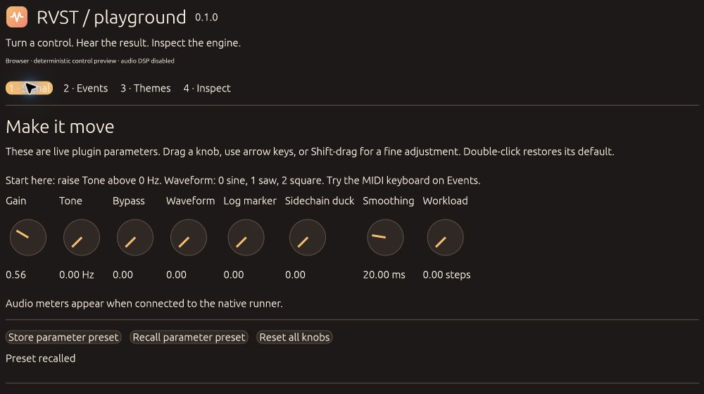
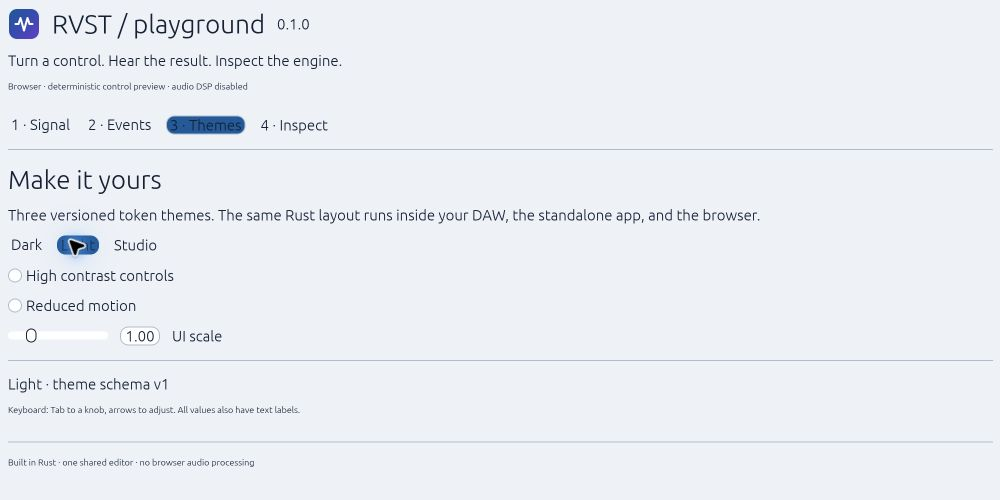
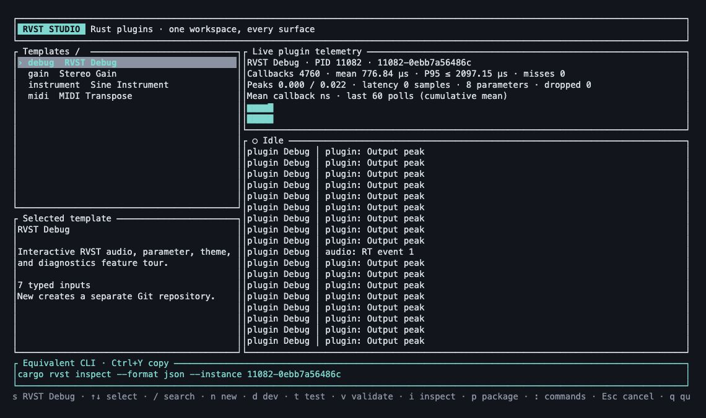
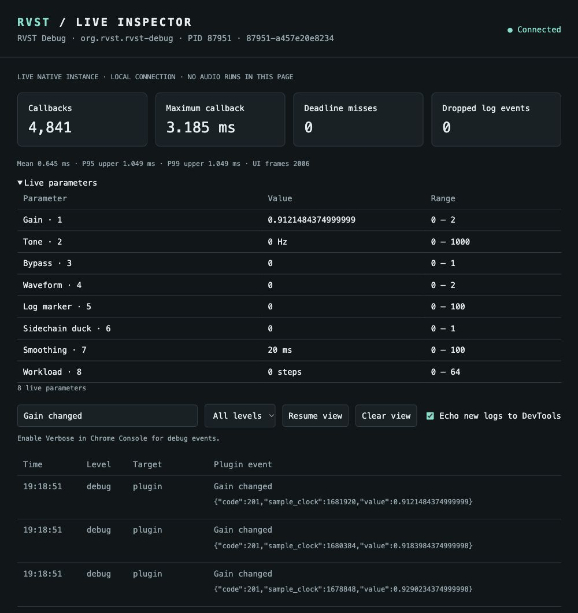

# RVST

**Build audio plugins in Rust. Share the editor. Own the whole project.**

Build VST3 and CLAP plugins with direct Rust adapters, a skinnable egui editor,
and a Cargo-native CLI/TUI. Run the same editor in your DAW, a standalone app,
or a browser through WebAssembly. Every plugin gets its own repository.



*The actual egui editor compiled to WebAssembly. This browser preview uses a
deterministic simulated host; audio processing runs natively.*

[Get started](docs/getting-started.md) · [Documentation](docs/README.md) ·
[CLI reference](docs/cli.md) · [Agent skills](docs/agent-skills.md) · [Contributing](CONTRIBUTING.md)

> **Development preview:** the SDK and CLI are not published on crates.io yet.
> Use the source workflow below. Native validators and Chrome checks pass on
> the tested macOS configuration; [DAW and platform qualification is tracked
> separately](docs/validation-2026-10-30.md).

## Install RVST

On macOS, Linux or WSL, run the setup wizard:

```sh
curl -fsSL https://raw.githubusercontent.com/S33G/rvst/main/scripts/install.sh | sh
```

[Read the installer script](scripts/install.sh) before running it. The wizard
checks for Rust and Cargo, explains its WSL behavior, downloads the current
`main` source, and builds the `rvst` and `cargo-rvst` executables into Cargo's
`bin` directory. Cargo's `--force` replaces an existing install. It does not
install audio plugins or edit your shell profile. If Cargo's bin directory is
missing from `PATH`, the wizard prints the command to add it.

Optional manual route, from an RVST checkout:

```sh
cargo install --path crates/cargo-rvst --locked --force
```

Then use `rvst --help` or `cargo rvst --help`. Windows users can use the manual
Cargo route from PowerShell.

## What the SDK gives you

Write your processor and editor once. RVST supplies the host adapters, development
runners and project tooling around them.

| Build your plugin | RVST provides |
| --- | --- |
| Effects, instruments and MIDI tools | Direct VST3/CLAP adapters, audio buses, sidechains, f32/f64 processing and sample-offset events |
| Automatable controls | Stable parameter identities, ranges, smoothing, gestures, built-in undo/redo and versioned processing state |
| An editor that feels like your product | Shared egui components, theme packs, fonts, artwork, scaling and keyboard controls |
| A fast development loop | Native standalone runner and WASM preview of the same Rust UI |
| Visibility into a running instance | Structured plugin logs, live parameter inspection, callback timing and queue/drop counters |
| Repeatable debugging | Capture/replay tools, offline tests and native debugger workflows |
| A repository you own | Cargo workspaces, Git, shareable Liquid templates, build helpers and agent-friendly commands |

The adapters are owned by RVST; there is no nice-plug backend. The SDK is split
into small crates, so the CLI does not pull in audio or graphical backends.
[Architecture and boundaries →](docs/architecture.md)

## Start with RVST Debug

RVST Debug is a hands-on framework tour. Turn a knob, play a note, switch the
skin, recall a preset, then follow the real plugin events into your browser.

Clone the framework, then run one command to create, build, install and open
its separate showcase project:

```sh
git clone https://github.com/S33G/rvst.git
cd rvst
```

```sh
rvst showcase --path ../rvst-debug --sdk-path . --vendor-sdk --install --run --open
```

This installs VST3/CLAP bundles in your **user plugin folders**, starts the
standalone app and opens its local inspector. Start at low gain; raise **Tone**
to hear the oscillator, or try the note buttons on **Events**.

- **Preview the operation:** add `--dry-run --format json`.
- **Build only:** omit `--install --run --open`.
- **Run it again:** `cd ../rvst-debug && cargo run -p plugin-standalone`.
- **Stop:** close the standalone window or press Ctrl-C in its terminal.

The generated repository contains a portable SDK snapshot. It builds without
this checkout or an installed RVST command. See [prerequisites and the complete
tour](docs/getting-started.md) if your machine needs setup.

## One editor, your visual identity

Keep layout and behavior in Rust. Skin colors, typography, spacing, controls and
meters with a versioned theme manifest. Dark, Light and Studio packs ship with
the framework; accessibility controls include scaling, high contrast and reduced
motion.



*Same shared editor, different theme. This is the browser runner, not an HTML
recreation of the plugin UI.* [Build a theme pack →](docs/themes.md)

## Choose your interface

### RVST Studio: a workbench in your terminal



Browse and search starters, create an independent plugin repository, then develop,
test and package from the keyboard. Native plugin logs and callback metrics feed
the workbench while you work. Press `:` for the command palette, `/` to filter
templates, or Ctrl-Y to copy the displayed CLI command.

*Actual TUI output from a 130 × 36 terminal, rendered with xterm.js. Telemetry
comes from RVST Debug's native standalone instance. [Capture notes](docs/screenshots/README.md#terminal-workbench-captures).*

Start Studio in an interactive terminal:

```sh
rvst
```

### The same operations for humans and agents

The TUI and explicit CLI commands use the same Rust operation layer. Use JSON
or JSONL for scripts, with versioned results and consistent exit codes.

| Interface | Start here |
| --- | --- |
| Studio TUI | `rvst` in an interactive terminal (`cargo rvst` also works) |
| Agent / script | `rvst --help` and `rvst schema --format json` |
| Generated RVST plugin project | `cargo build --locked`, then `cargo xtask bundle --release` |

The tool does not build native audio or graphical backends during installation.
The [setup wizard](scripts/install.sh) installs the command-line tools. RVST
uses Cargo's package installation and dependency resolution.

## Make your own plugin

From the **framework checkout**, with the workbench installed:

```sh
rvst new ../my-effect \
  --template gain \
  --vendor Acme \
  --id com.acme.my-effect \
  --sdk-path . --vendor-sdk \
  --non-interactive
cd ../my-effect
cargo build --locked
cargo test --workspace --locked
cargo xtask bundle --release
```

| Starter | Explore |
| --- | --- |
| `debug` | Interactive tour, diagnostics, themes and native/browser workflows |
| `gain` | Parameters, smoothing, bypass, meters and presets |
| `instrument` | Voices, sample-offset notes, pressure and pitch bend |
| `midi` | Event transformation, with pure-MIDI or audio pass-through variants |

Use `rvst templates inspect gain --format json` to discover inputs.
[Template authoring](docs/templates.md) covers local and pinned Git templates.

## Preview the real Rust UI in a browser

From a **generated plugin repository**:

```sh
rustup target add wasm32-unknown-unknown
cargo install wasm-bindgen-cli --version 0.2.130 --locked
cargo xtask web --serve --open
```

Browser v1 uses a deterministic simulated host. It tests the shared Rust editor;
audio runs in the native plugin or standalone app.

## See inside a running plugin



*Captured from RVST Debug's native standalone instance on macOS. The log view is
paused on real parameter-change events; timing values are a session snapshot,
not a benchmark or DAW qualification.*

Open the local inspector to follow structured logs, current parameters, callback
timing distributions and dropped-event counters. Enable **Echo new logs to
DevTools** to see incoming plugin events in Chrome's Console. The connection is
local and authenticated; no cloud service is required.

```sh
cargo rvst inspect --format json
cargo rvst inspect --open --instance INSTANCE_ID
```

Use an instance ID from the first command. Chrome debugs the inspector and WASM
UI; stepping through native DSP uses LLDB/GDB. Recordings can feed offline replay
and block stepping. [Logs, recording and debugger setup →](docs/diagnostics.md)

## A normal Rust project after generation

The generated workspace separates responsibilities so your DSP, editor and host
integration can evolve independently:

```text
my-effect/
├── crates/
│   ├── plugin-core/        # Processor, parameters and state
│   ├── plugin-ui/          # Shared Rust editor
│   ├── plugin-native/      # VST3 / CLAP exports
│   ├── plugin-standalone/  # Native development runner
│   ├── plugin-web/         # WASM browser entry point
│   └── xtask/              # Build, preview and bundle commands
├── Cargo.toml
└── Cargo.lock
```

Use `cargo build`, `cargo test`, `cargo fmt` and `cargo clippy` as usual. The
vendored starter above builds after cloning elsewhere, even with RVST removed
from `PATH`. No parent workspace changes, background package manager or silent
regeneration of authored code.

## Explore the framework

| Area | Crates | Guide |
| --- | --- | --- |
| Processing and events | `rvst-core`, `rvst-runtime` | [API contracts](docs/api-contract.md) |
| Native formats | `rvst-adapter`, `rvst-vst3`, `rvst-clap` | [Architecture](docs/architecture.md) |
| Shared UI and runners | `rvst-ui`, `rvst-platform`, `rvst-standalone`, `rvst-web` | [Themes](docs/themes.md) |
| Debugging and tests | `rvst-devtools`, `rvst-test` | [Diagnostics](docs/diagnostics.md), [real-time rules](docs/realtime.md) |
| Tooling | `rvst-build`, `rvst-ops`, `cargo-rvst` | [CLI](docs/cli.md), [templates](docs/templates.md) |

Build API documentation with `cargo doc --workspace --no-deps --open`.
The [documentation index](docs/README.md) links guides, capability reports and
release evidence. [Screenshot capture notes](docs/screenshots/README.md) describe
the examples shown above.

## Open source

RVST and its starters use **MIT OR Apache-2.0**. Proprietary downstream plugins
are allowed; review the licences of the dependencies and assets you distribute.
See [MIT](LICENSE-MIT), [Apache-2.0](LICENSE-APACHE), and
[third-party notices](THIRD_PARTY_NOTICES.md).

[Contributing](CONTRIBUTING.md) explains checks and commit conventions.
[HISTORY.md](HISTORY.md) explains the reconstructed dates in the initial import.
