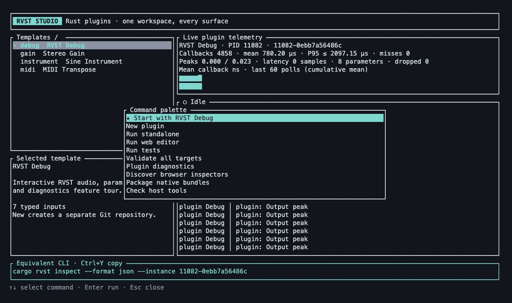

# CLI and TUI reference

[Documentation](README.md) / CLI and TUI

The CLI and Studio call the same Rust operation layer. Every Studio operation
has an explicit command for scripts and agents. Run `cargo rvst --help`, or
append `--help` to a subcommand, for the current parser's complete flags.

## Choose a project

Run commands inside a generated plugin repository, or select it explicitly:

```sh
cargo rvst test --manifest-path ../my-effect/Cargo.toml
cargo rvst validate --project ../my-effect --format json
```

`--manifest-path` selects the manifest's directory. `--project` selects a working
directory. Paths used for `new`, template registration and SDK selection should
be supplied relative to the directory from which you invoke the command.

## Commands

| Command | Purpose | Example |
| --- | --- | --- |
| `showcase` | Create/build the RVST Debug tour; optionally install and run | `cargo rvst showcase --sdk-path ../rvst --vendor-sdk --run --open` |
| `new` | Generate a separate plugin repository | See [generation example](#generate-without-prompts) |
| `templates list` | List bundled and registered templates | `cargo rvst templates list --format json` |
| `templates inspect` | Show manifest and typed inputs | `cargo rvst templates inspect gain --format json` |
| `templates check` | Validate a template | `cargo rvst templates check --path ./my-template` |
| `templates add` | Register a local or pinned Git template | See [template registration](templates.md) |
| `doctor` | Check prerequisites and report setup commands | `cargo rvst doctor --format json` |
| `dev` | Run the native standalone app | `cargo rvst dev` |
| `dev --web` | Build and serve the shared Rust UI | `cargo rvst dev --web --open` |
| `test` | Run workspace tests | `cargo rvst test` |
| `validate` | Run workspace tests across targets | `cargo rvst validate --format json` |
| `debug` | Print plugin metadata and native debugger guidance | `cargo rvst debug` |
| `inspect` | Read live native logs, state and metrics | `cargo rvst inspect --format json` |
| `replay` | Replay an existing DSP recording | `cargo rvst replay capture.json --step` |
| `package` | Build VST3/CLAP bundles | `cargo rvst package --release --plugin-format all` |
| `schema` | Print command discovery and versioned JSON schemas | `cargo rvst schema --format json` |
| `studio` | Open the interactive terminal workbench | `cargo rvst studio` |

`validate` runs Cargo tests. It does not run external format validators or
qualify a DAW. `package` creates bundles; installation is an explicit generated
project command: `cargo xtask install`.

## Generate without prompts

From the framework checkout, after installing the CLI:

```sh
cargo rvst new ../my-effect \
  --template gain \
  --vendor Acme \
  --id com.acme.my-effect \
  --sdk-path . --vendor-sdk \
  --non-interactive --format json
```

An existing destination is a conflict. The template's typed inputs also accept
repeatable `--set NAME=VALUE` flags. Inspect the template first to discover its
accepted inputs and defaults. See [templates](templates.md) for source modes,
provenance and local/Git registration.

## Shared flags

| Flag | Meaning |
| --- | --- |
| `--format human\|json\|jsonl` | Human output, one JSON result, or a JSONL event stream; `--output` is an alias |
| `--non-interactive` | Never enter Studio or prompt |
| `--dry-run` | Plan an operation without generation, builds, installation or launch |
| `--quiet` | Suppress live human task logs |
| `--manifest-path PATH` | Select a Cargo manifest |
| `--project PATH` | Select the project working directory |
| `-p`, `--package NAME` | Select a Cargo package |
| `--target TRIPLE` | Forward a Rust target to build/test operations |
| `--profile NAME` | Forward a Cargo profile |
| `--features LIST` | Forward comma-separated Cargo features |

For packaging, use `--release` or `--profile NAME`, not both. Use
`--plugin-format all|vst3|clap` to choose plugin formats; the global `--format`
flag always controls command output.

A dry run may read project/template metadata to construct its plan. It does not
establish that a later compiler, host or validator run will succeed.

## Machine output and exits

Use explicit subcommands in automation. Bare `cargo rvst` requires interactive
input and human output. Opening a browser requires an explicit `--open`.

```sh
cargo rvst package --dry-run --format json
cargo rvst test --format jsonl
cargo rvst inspect --instance INSTANCE_ID --format json
```

JSON operations emit one versioned result or error record. JSONL tasks can emit
start, log and final records; parse each line independently. The `schema` command
publishes the result and recording schemas plus command names. Help/version
output is clap's ordinary text output; use `schema` for machine discovery.

| Exit | Meaning |
| ---: | --- |
| `0` | Success |
| `1` | Operation, test or I/O failure |
| `2` | Invalid invocation or input |
| `3` | Missing prerequisite or incompatible template |
| `4` | Destination or registration conflict |
| `130` | Cancelled |

For errors, use `error.code` for classification and `error.message` for a human
explanation. Optional `error.details` carries check or child-process information.
The inspector omits private capability URLs from its machine snapshots.

## Studio keyboard map



Press `:` from the main view to open this palette. Select an action with the
arrow keys and press Enter. The underlying operations are also available as
explicit CLI commands. This image is a [render of captured terminal output](screenshots/README.md#terminal-workbench-captures).

Studio manages the current project. Open it from that repository with
`cargo rvst`, or use `cargo rvst studio --project PATH`.

| Key | Action |
| --- | --- |
| ↑ / ↓ or `k` / `j` | Move through templates or palette choices |
| `/` | Search templates |
| `:` | Open the command palette |
| Enter / `n` | Create from the selected template |
| `s` | Start the RVST Debug wizard |
| Tab / Shift-Tab | Move between wizard fields |
| F2 | Toggle SDK vendoring in the wizard |
| `d` / `t` / `v` / `p` | Develop / test / validate / package |
| `i` | Discover native inspectors |
| Ctrl-Y | Copy the displayed CLI command using the terminal's OSC 52 support |
| Esc | Leave a mode, or cancel a running task from the main view |
| `q` | Quit from the main view |
| Ctrl-C | Cancel active work; exit when idle |

The footer displays the equivalent command. Jobs and inspector polling run on
background workers; closing the workbench cancels its owned work and restores
the terminal. Clipboard behavior depends on the terminal's OSC 52 support.

Continue with [diagnostics](diagnostics.md) for live telemetry or
[workbench status](cli-status.md) for implementation and coverage boundaries.
